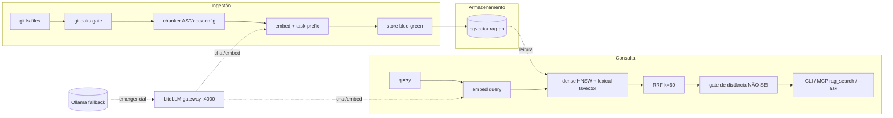
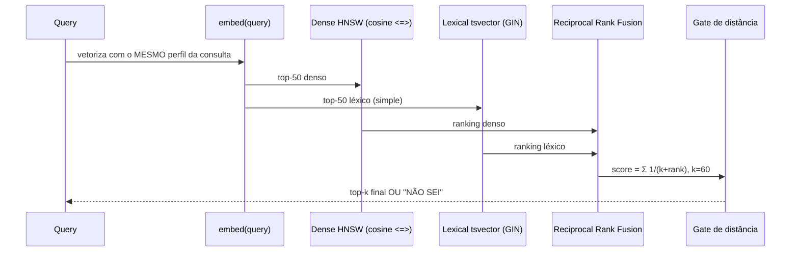

# Como funciona o nosso RAG

> Apresentação técnica do pipeline de recuperação (Retrieval-Augmented Generation)
> do `ecollm-stack`. Números validados contra o índice ao vivo em **2026-10-14**.

---

## 1. Visão geral — objetivo e decisão de design

O sistema é um **RAG local sobre repositórios de código**, construído **sem framework**
(LlamaIndex / LangChain). A decisão central foi *build vs buy*: preferimos um pipeline
enxuto e auditável (~mil linhas de Python explícito) a uma caixa-preta de framework.

Princípios que sustentam toda a arquitetura:

- **Um espaço vetorial por modelo.** Cada *embedder* tem sua própria tabela; nunca se
  misturam vetores de modelos diferentes num mesmo índice (a semântica não é portável).
- **Recuperação híbrida determinística.** Denso + léxico fundidos por RRF, com ordenação
  estável pensada para **economia de prompt-cache**.
- **Fail-closed.** Se o índice não cobre a pergunta ou está obsoleto, o sistema diz
  **"NÃO SEI"** em vez de alucinar.
- **Código-fonte vence doc.** Em conflito, o que está no repositório é a verdade.



---

## 2. Arquitetura — componentes

| Componente | Serviço | Papel |
| --- | --- | --- |
| **Gateway LLM** | `ai-litellm` (`litellm/config.yaml`, porta 4000) | roteamento, fallbacks, cache de prompts, chaves. Toda chamada de chat/embedding passa por aqui. |
| **Banco vetorial** | `ai-rag-db` (`pgvector/pgvector:pg17`, loopback `127.0.0.1:5433→5432`) | guarda os vetores (`halfvec`), índices **HNSW** (cosine) e **GIN** (tsvector). |
| **Fallback local** | `ai-ollama` (porta 11434) | modelo emergencial `qwen3:4b-instruct-2507-q4_K_M`; também serve embedders locais (bge-m3, qwen3-embedding). |
| **Registry de perfis** | `ingest/profiles.py` | define cada espaço vetorial: tabela + modelo + dimensão + política de prefixo + gate + batch. |
| **Servidor MCP** | `mcpsrv/rag_server.py` (stdio) | expõe a ferramenta `rag_search` para agentes (Copilot/Roo). |

### Perfis de embedding (cada um = um espaço vetorial isolado)

| Perfil | Tabela | Dim. | Prefixo | Gate (dist.) | Status |
| --- | --- | --- | --- | --- | --- |
| `gemini` | `chunks` | 3072 | `prefix-gemini` (assimétrico) | 0,34 | histórico (836 chunks) |
| **`qwen37`** | `chunks_qwen37` | 1024 | `none` | **0,50** | **ativo na leitura** |
| `bgem3` | `chunks_bgem3` | 1024 | `none` | default | local, $0 (705 chunks) |

Precedência de perfil: `RAG_PROFILE` (env) > `published_profile` (db) > `DEFAULT_PROFILE` (`bgem3`).
Hoje o `.env` fixa **`RAG_PROFILE=qwen37`**.

---

## 3. Pipeline de ingestão (escrita do índice)

Fluxo `loader → chunker → embed → store` executado **numa única transação**
(`ingest/ingest.py`), orquestrado por `rag-sync`.

**a) Loader** (`ingest/loader.py`)

- Enumera arquivos com `git ls-files -z` (respeita `.gitignore`).
- Calcula `blob_sha` por arquivo e `content_sha256` do **texto puro** (sem prefixo de tarefa).

**b) Gate de segurança**

- Roda **gitleaks no corpus inteiro antes de indexar**. Se detectar segredo, **aborta com exit 2** — nada sensível entra no índice.

**c) Chunker** (`ingest/chunker.py`) — três estratégias por tipo de conteúdo:

- **code**: parse **tree-sitter** (AST). Um chunk por função/método/classe; órfãos entram em janela deslizante de ~400 tokens sem overlap. Cap 512 tok, mínimo 25 tok.
- **doc**: divide por cabeçalho `##`; mescla blocos < 100 tok, splita > 512 tok com overlap ~12%.
- **config**: yaml/json/toml agrupados por chave de topo (pack ~300, cap 512 tok).
- O chunk guarda **texto puro**; o prefixo de tarefa é aplicado só depois, no embed.

**d) Embed** (`ingest/embed.py`)

- `embed_texts` com lote, retry e backoff via LiteLLM.
- `apply_prefix(text, kind, policy)`: prefixo **assimétrico** `"query:"` / `"doc:"` apenas nos modelos instruction-tuned (Gemini); `qwen37`/`bgem3` usam `none`.

**e) Store** (`ingest/store.py`) — sincronização **incremental** e **blue-green**:

- Incremental por `blob_sha`: só re-embedda arquivos novos/mudados; inalterados são copiados adiante (*copy-forward*).
- `upsert_rows ON CONFLICT (repo, path, content_hash, gen)`.
- **Blue-green**: escreve na geração `gen = published + 1`, valida, então faz *flip* atômico (`publish_generation`) e coleta-lixo as gerações antigas. O leitor nunca vê índice pela metade.

---

## 4. Recuperação (leitura do índice)

Implementação em `ingest/search.py` — **busca híbrida**:



Pontos-chave:

- **Denso**: similaridade cosseno via operador `<=> ::halfvec`, varrida pelo índice **HNSW** (`ef_search` ajustável, default 50).
- **Léxico**: `tsvector` simples (peso pt-BR hoje **desligado**, `LEXICAL_PT_WEIGHT=0.0`).
- **Fusão RRF** (`reciprocal_rank_fusion`, `k=60`): combina os dois rankings sem depender de escalas comparáveis.
- **Ordenação determinística** (`_sort_final`): `score desc` + desempate fixo `(path, symbol, id)`. Isso mantém o **prefixo de prompt byte-estável** entre turnos → maximiza o hit de prompt-cache.
- **Gate de distância** (`PERFIL_GATE="profile"`): se o melhor vizinho passar do limiar do perfil (ex.: 0,50 no `qwen37`), o resultado é tratado como **"NÃO SEI"** — fail-closed.
- **Aviso de obsolescência** (`staleness_warning`): compara HEAD/dirty do git com `rag_sync_state`; se o índice estiver atrasado, retorna um `[aviso]` acionável com o comando `rag sync --repo … --profile …`.

---

## 5. Interfaces de uso

- **CLI** (`ingest/cli.py`):
  - `rag "consulta"` → lista hits com fonte (`path::symbol`), score e rank denso/léxico.
  - `rag --ask "pergunta"` → monta contexto + gera resposta via `ASK_MODEL_DEFAULT` (`qwen3.8-flash-fast`), **cita [n]** e responde **"NÃO SEI"** se o gate falhar. `SYSTEM_PROMPT` restringe a resposta aos trechos fornecidos.
  - `rag-sync` → dispara a ingestão incremental/blue-green.
  - Fail-closed: se o perfil pedido não está indexado, sai com `rc=3`.
- **MCP** (`mcpsrv/rag_server.py`): ferramenta `rag_search(query, k=8, kind?, path_prefix?)` → JSON `{results:[{path, symbol, kind, score, source, content}]}`. Reusa `search()` **verbatim** (mesmo RRF + ordem determinística). Aplica `DEFAULT_K=6` quando o cliente omite `k`; propaga o campo `stale`.

---

## 6. Avaliação

- **recall@k + MRR + por-kind** (`eval/recall.py` sobre `dataset.jsonl` / `dataset-v2.jsonl`).
- Portão canônico:

  ```bash
  RAG_PROFILE=qwen37 .venv/bin/python -m eval.recall --gate
  ```

- Resultado atual: **recall@8 = 0,933**.
- Observações estruturais: `qwen37` é o único candidato acima do portão 0,900; `bgem3` tem teto estrutural ~0,867 (fraqueza em prosa/doc); o prefixo de tarefa do Gemini não é portável entre embedders.
- **Cache economics** (`eval/cache_report.py`): lê SpendLogs e mede taxa de *cache hit* de prompt (~95% implícito) — a ordenação determinística do search é o que viabiliza esse número.

---

## 7. Estado ao vivo (2026-10-14)

| Métrica | Valor |
| --- | --- |
| Perfil de leitura ativo | `qwen37` (`RAG_PROFILE` no `.env`) |
| Índice publicado `qwen37` (gen 12) | **752 chunks** — code 699 · doc 27 · config 26 |
| `chunks_bgem3` (gen 5) | 705 chunks — code 667 · config 26 · doc 12 |
| `chunks` (gemini, histórico) | 836 chunks |
| recall@8 canônico | 0,933 |
| Gate de distância `qwen37` | 0,50 |
| `ai-rag-db` | Up (healthy) |

---

## 8. Decisões de design que valem destacar

1. **Zero framework** — pipeline auditável, cada etapa é código próprio.
2. **Espaço vetorial isolado por modelo** — evita contaminação cross-embedder.
3. **Sync blue-green** — publicação atômica, leitor nunca vê índice inconsistente.
4. **Incremental por blob_sha** — re-embed só do que mudou; custo marginal baixo.
5. **RRF + ordenação determinística** — qualidade de recuperação *e* economia de prompt-cache juntas.
6. **Fail-closed com "NÃO SEI"** — honestidade sobre cobertura; gate de distância + aviso de staleness.
7. **Gate gitleaks no corpus** — segredos nunca chegam ao índice.

---

*Comandos essenciais, hierarquia de autoridade e convenções operacionais: ver `.roo/rules/roo-core.md` e `.planning/AGENTS.md`.*
