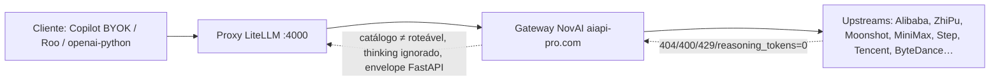

# Relatório consolidado — falhas e pendências do lado do servidor (NovAI)

**Data:** 2026-10-18
**Escopo:** todas as falhas medidas na trilha de testes da API NovAI (S102/S103,
Fases F–L, S114–S120) **que pertencem ao servidor** — gateway NovAI
(`https://aiapi-pro.com`), upstreams (Alibaba/ZhiPu/Moonshot/MiniMax/Step/…) e
o nosso proxy LiteLLM (`:4000`). Falhas de código nosso já corrigidas aparecem
só como contexto.

**Fontes (evidência primária):** `reports/novai-test-matrix.csv` (157 linhas),
`reports/2026-10-17-novai-fase-{f,g,h,i,j,k,l}.md`,
`reports/2026-10-17-novai-s11{4,5,6}-*.md`,
`reports/2026-10-17-novai-contrato-api.md`, `reports/2026-10-17-novai-tool-scan.md`,
`reports/2026-10-17-roo-byok-causa-raiz.md`, `.planning/20-BACKLOG.md` §S112–S120.

---

## 0. Números-chave (estado medido 2026-10-17/18)

| Métrica | Valor |
| --- | --- |
| Matriz de cobertura (157 grupos) | **103 pass · 3 fail · 35 skip · 16 removed** |
| Sweep de contrato de erro (S115) | 440 checks → **440 pass / 0 fail** |
| Contrato OpenAI de shape (S117) | 11 pass · **1 diverged** (error envelope) · 1 skipped |
| Sweep de tools (S119/S120, 212 modelos) | **112 linhas irregulares** (erros + assimetrias) |
| Suíte offline | **942 passed / 1 skipped** |
| Fails residuais acionáveis por nós | **0** (todos são gateway/upstream) |

Os 3 fails restantes da matriz são a classe D (contabilidade de reasoning, §2.3).
As 16 rotas mortas foram removidas do `config.yaml` no S114 mas **persistem no
catálogo do gateway** (§2.1).

---

## 1. Mapa de responsabilidade



- **Divergência proxy ≠ gateway ⇒ bug nosso (LiteLLM config).** Foi o método da
  Fase F: nada divergiu por config nossa; todas as divergências apontaram para o
  gateway/upstream.
- **Ambos os alvos falham igual ⇒ servidor NovAI/upstream.** É o caso da maioria.

---

## 2. Falhas do lado do servidor (gateway NovAI + upstreams)

### 2.1 Catálogo anunciado ≠ catálogo roteável — 16 ids mortos (permanente)

- **Sintoma:** `HTTP 404 {"error":{"message":"[Alibaba Cloud] Model not exist."}}`
  nos 16 grupos, medido **direto no gateway** (sem proxy), com controle positivo
  200 no mesmo instante (`qwen3.8-max`, `qwen-plus`).
- **Os ids estão no `/v1/models` do gateway** (121 entradas anunciadas) — o
  provider Alibaba não os serve mais. Config nossa estava correta (investigado
  em L1/§3g, hipótese "id errado" refutada).
- **Ids mortos:** chat 12 (`qwen3.6-max-preview`, `qwen3-max`, `qwen3-coder-plus`,
  `qwen-vl-max`, `qwen3-vl-flash`, `qwen-omni-turbo` × ON/OFF) + image 2
  (`qwen-image`, `qwen-image-plus`) + tts 2 (`qwen-tts-latest`, `qwen-tts`).
- **O que fizemos:** removidos do `config.yaml` (S114, catálogo 168→152).
- **Pendência do fornecedor:** o gateway **continua anunciando os 16 ids** no
  `/v1/models` dele. Cliente que confie no catálogo descobre o 404 só em runtime.
  Mesma família do gap S100 (vídeo: 20 no catálogo, 9 roteáveis).
- Evidência: `reports/2026-10-17-novai-s114-remocao-grupos-mortos.md`,
  `2026-10-17-novai-fase-l.md` §3g.

### 2.2 Kimi/ZhiPu: não existe modo thinking OFF — 9 rotas `-fast` inválidas

- **Sintoma:** `HTTP 400` quando o payload carrega `thinking:{type:"disabled"}`:
  - Moonshot (Kimi): `"The request is invalid: the request was rejected by an
    internal MaaS component"` (5 grupos: `kimi-k2.5/k2.6/k2.7-code/
    k2.7-code-highspeed/k2.8-preview-fast`).
  - ZhiPu (GLM): `"该模型始终思考，不支持关闭思考；请使用 low、high 或 max"`
    (`glm-5.3-fast`, `glm-5.3-flash-fast`) ou a mesma mensagem MaaS
    (`glm-5-turbo-fast`, `glm-5.3-flashx-fast`).
- **Causa raiz re-medida (S115 retomada, 2026-10-17):** testando o gateway
  **direto**, `thinking:{type:"enabled"}` dá **200** nos 9 upstreams; `disabled`,
  `low`, `high` e `max` dão **400**. Ou seja: o upstream não rejeita o campo —
  rejeita os **valores de controle**; `enabled` é o único válido (validação de
  enum do componente MaaS). A mensagem "sempre pensa" só aparece no `glm-5.3-fast`.
- **`reasoning_effort: low` funciona como workaround** (aceito + reduz raciocínio)
  — foi a correção aplicada no S116 aos 9 blocos `-fast` do `config.yaml`.
  Mas **não desliga** o reasoning (medido em L3: `thinking:{type:"low"}` também
  400; `reasoning_effort:low` mantém tokens de reasoning). Veredito canônico =
  `skip` (não existe modo off nesses upstreams).
- **Pendência do fornecedor:** publicar uma forma real de desligar o reasoning
  (ou documentar que não existe), para que a convenção "`-fast` = thinking OFF"
  valha para essas famílias.
- Evidência: `2026-10-17-novai-fase-l.md` §3c, `2026-10-17-novai-s116-fails-corrigiveis.md`,
  `20-BACKLOG.md` §S115(a).

### 2.3 Contabilidade de reasoning quebrada — 3 fails permanentes na matriz

- **Sintoma:** a rota `-fast` retorna HTTP 200 com `reasoning_content` preenchido
  mas `usage.reasoning_tokens = 0` (ou parcial):
  | Grupo | Evidência medida |
  | --- | --- |
  | `novai-minimax-m2.7-fast` | `reasoning_chars=79–150`, `reasoning_tokens=0` |
  | `novai-minimax-m2.5-fast` | `reasoning_chars=90–173`, `reasoning_tokens=23–48` (subcontabilizado) |
  | `novai-step-5-preview-fast` | `reasoning_chars=123–130`, `reasoning_tokens=0` |
- **Diagnóstico:** o upstream MiniMax/Step **ignora o pedido de thinking OFF**
  (emite reasoning mesmo na rota `-fast`) **e** não contabiliza os tokens de
  reasoning em `usage`. Dupla divergência de contrato: comportamento + contabilidade.
- **Não acionável por nós** — só o gateway/upstream conserta. É o que sustenta os
  3 `fail` atuais da matriz.
- Evidência: `2026-10-17-novai-s116-fails-corrigiveis.md`, matriz (linhas D).

### 2.4 Gateway ignora `extra_body.thinking:{type:disabled}` — achado **A6** (aberto)

- **Sintoma (medição limpa, Fase F re-rodada + Fase I I5):** mesmo payload,
  dois alvos: proxy repassa e o modelo obedece (`reasoning_tokens=0`, 2 tokens);
  gateway aceita o campo mas **não repassa** (`reasoning_tokens=123`, 126 tokens
  vs 2). Divergência **proxy ≠ gateway ⇒ defeito do gateway** no método dual-target.
- **Impacto:** qualquer cliente que aponte direto ao gateway e tente controlar
  thinking via `extra_body` recebe custo/comportamento inesperado silencioso
  (aceito com 200, ignorado na prática).
- **Status:** aberto — fora do nosso alcance; registrado em
  `PLANO-TESTES-NOVAI.md` §9b e §S115(c). Critério de fechamento: gateway
  corrigir ou documentar a limitação.

### 2.5 Envelope de erro inconsistente no gateway — divergência de contrato

- **Medido no sweep S115 (440 checks, 110 grupos × 2 casos × 2 alvos) e S117:**
  - Erro **do próprio** gateway (ex.: modelo inexistente): FastAPI cru
    `{"detail": "Model 'xxx' not supported. Available: ..."}` — **fora do
    padrão OpenAI**. SDKs tipados (`openai-python`) esperam
    `{"error":{message,type,param,code}}` e podem quebrar ou perder o tipo do erro.
  - Erro **repassado de upstream**: envelope OpenAI correto
    (`{"error":{"message":"[ZhiPu (智谱)] ...","type":"upstream_provider_error"}}`).
  - Nenhum devolve **404** para modelo inexistente — ambos usam **400**
    (divergência menor, documentada; o harness aceita `(400,404)`).
  - O proxy LiteLLM normaliza tudo para OpenAI — a inconsistência é só no gateway.
- **Pendência do fornecedor:** unificar o envelope de erro em formato OpenAI em
  todos os caminhos. Evidência: `2026-10-17-novai-s115-sweep-contrato-erro.md`,
  `2026-10-17-novai-contrato-api.md` (única linha `diverged`).

### 2.6 Contrato de tools: stream emite fala junto de `tool_calls` (assimetria OpenAI)

Medido em escala no S119/S120 (212 modelos, non-stream + stream cada; evidência
crua versionada em `reports/logs/tool-scan-2026-10-17-{gateway,proxy}.jsonl`):

- **23 linhas stream** emitem `delta.content` **antes/depois** de
  `delta.tool_calls` com `finish_reason=tool_calls` — na convenção OpenAI, um
  stream de tools carrega **apenas** `delta.tool_calls`, sem fala. Bases
  afetadas: `glm-4.6v`(+flash), `glm-5/5.1/5.2`, `glm-5v-turbo`,
  `hunyuan-t1-vision`, `kimi-k2.8-preview`, `kimi-k3`, `minimax-m3` (+ espelhos
  `-fast` no proxy). Proxy e gateway **concordam** na família ⇒ origem = gateway/upstream.
- **28 linhas non-stream** trazem `content` **e** `tool_calls` juntos (dupla
  narração possível em agentes).
- **4 modelos ignoram a ferramenta** (respondem texto puro, `args=ausente/INVALID`):
  `glm-4.1v-thinking-flash`, `hy-vision-2.0-instruct` (+ `-fast`) — candidatos a
  excluir da whitelist de tools dos agentes.
- **Shape do tool_call em si nunca está quebrado** (nenhuma linha com args
  não-parseáveis; granularidade varia: fragmentado 88 × chunk_único 40 — ambos
  válidos).
- **Instabilidade entre corridas** (transiente de rede/gateway):
  `glm-4.6v-flash`, `glm-4.7-flash`, `mimo-v2.6-pro`, `qwen-omni-turbo`,
  `qwen3-vl-flash` deram erro de transporte numa corrida e passaram em outra;
  `minimax-text-01` stream sem `[DONE]` em ambas.
- **Nota de stack (nosso, mitigado):** Fase K K1 — a fragmentação dos deltas
  exigiu `merge_tool_calls()` no harness; clientes que contam fragments crus
  veem tools fantasmas. Não é bug do gateway (OpenAI também fragmenta), mas o
  gateway mistura fala+tools, o que agrava.
- Evidência: `2026-10-17-novai-tool-scan.md` (rollup + conclusão), §S118/§S119 backlog.

### 2.7 Upstream derruba conexão / falhas transitórias de rede

- `wan2.2-t2i-flash` (image): `RemoteDisconnected` determinístico (N=3) enquanto
  `wan2.5-t2i-preview` respondia 200 no mesmo instante (G3, Fase G). No re-teste
  de 2026-10-17 passou — tratado como transitório (classe G zerada).
- `cogvideox-flash` (vídeo): instável (J3); `minimax-video-v2.3-fast`: tarefa
  assíncrona termina `FAILED` (J4) — upstream MiniMax vídeo.
- ZhiPu no gateway: 429 frequente (`该模型当前访问量过大`) — o proxy absorve
  melhor que o gateway direto; mitigado por retry com backoff honrando
  `Retry-After` (L5).
- `seedream-image-v5.0-lite`: 400 se `size ≤ 1024²` — tamanho mínimo maior que o
 文档 sugere (mitigado com override `2048x2048`, L4).

### 2.8 Assimetrias de endpoint no gateway (documentadas, não bloqueantes)

- `GET /models` só aceita GET no proxy (POST → 405); nomes de imagem no gateway
  aparecem **sem** prefixo `novai-image-` (G4).
- Rota 3D correta: `/v1/three_d/generations` — `/v1/3d/generations` dá **405** (J).
- Passthrough `/novai/video|3d` só existe no **proxy** (`pass_through_endpoints`);
  no gateway direto → 405; e o passthrough **não traduz corpo** (`model:"default"`
  → 400, exige id real do catálogo) (L6).
- Embeddings: `*-vl-embedding-*` (Tencent) exige `input` multimodal
  `[{"type":"text",...}]` — lista de strings → 400 "input is invalid or missing"
  (H1; workarounded no harness).
- `text-embedding-v4` dim = 1024; `kinfra-vl-8b` = **4096** (acima do teto
  `halfvec`=4000 → coluna `vector`, H2 — restrição pgvector nossa, resolvida).
- ASR: respostas 200 com `text:""` quando o fixture era tom puro — era bug NOSSO
  de fixture (G1), corrigido; `wand-asr-v1` transitório fechado no re-teste.

---

## 3. Falhas do nosso servidor (proxy LiteLLM / stack) — estado

| Item | Sintoma | Estado |
| --- | --- | --- |
| S112 — 429 `all_deployments_in_cooldown` | grupo de 1 deployment + default global `allowed_fails=3` colocava o único deployment em cooldown ao primeiro 429 | ✅ **corrigido**: `router_settings` (`allowed_fails:5`, `cooldown_time:15`) no `config.yaml`; validado `Cooldown Deployments=[]` × 3 chamadas |
| S113 — `DEEPSEEK_API_KEY` inválida (401) | família `deepseek-*` (não-NovAI) toda morta no upstream DeepSeek | ⏸️ **decisão do usuário**: chave desativada de propósito, escopo é NovAI. Reativar = repor chave no `.env` + `docker compose up -d litellm` |
| Roo Code travava em "API Request…" | 4× `401 "Virtual Key expected. Received=lite****cret"` nas SpendLogs — placeholder da UI digitado como chave; preflight `/v1/models` falhava antes do stream | ✅ **causa raiz determinada + corrigida** (virtual key `roo-code-s115`); aceite atingido: 6 linhas `RooCode success` + confirmação do usuário (2026-10-18) |
| Cache de modelos do Roo | 168 entradas pré-S114, ainda listava 14 dos 16 grupos mortos | ⬜ fazer "Refresh Models" no perfil NovAI (ação manual, baixa) |
| Logs do proxy apagados por restart | container reiniciou 16:25 e perdeu histórico do incidente Roo | ℹ️ mitigação futura: persistir logs do LiteLLM (json_logs/volume) — não aberto formalmente |

Bugs NOSSOS de harness encontrados e **já corrigidos** durante a trilha
(contexto, para completeness): H1/H2 (embeddings), G1/G2 (fixtures ASR/size),
I1/I2 (orçamento de tokens/content vazio), J1/J2 (campo `n`, GET no poll),
K1 (merge de tool_calls), S115-fix (expected 404→(400,404)), captura por-check
(Fase F), `make_capturing_sender` sem `method=` (S117).

---

## 4. Pendências (o que resta)

**Do lado do fornecedor (NovAI/upstream) — nada acionável localmente:**

1. **P-1** Remover/reativar os 16 ids mortos do `/v1/models` do gateway
   (catálogo ≠ roteável). Enquanto isso, nosso proxy já não os anuncia.
2. **P-2** Oferecer um mecanismo funcional de thinking-OFF para Kimi/ZhiPu
   (hoje só `enabled` é válido; `disabled/low/high/max` → 400).
3. **P-3** Corrigir contabilidade `reasoning_tokens` (MiniMax m2.5/m2.7, Step-5)
   e respeitar o pedido de thinking OFF nessas rotas.
4. **P-4** Aceitar/repassar `thinking:{type:disabled}` no gateway (**A6**) — hoje
   aceita o campo e silencia.
5. **P-5** Unificar envelope de erro em formato OpenAI (hoje `{detail}` FastAPI
   para erros próprios).
6. **P-6** Alinhar stream de tools à convenção OpenAI (não emitir `delta.content`
   junto de `tool_calls`) — 23 linhas confirmadas em escala.
7. **P-7** Estabilidade: `RemoteDisconnected` intermitentes
   (`wan2.2-t2i-flash`, `mimo-v2.6-pro`, glm no gateway), `minimax-text-01`
   stream sem `[DONE]`, tarefas vídeo `FAILED` (`minimax-video-v2.3-fast`).

**Do nosso lado — administrativas:**

8. **P-8** Rodar `--passthrough` e registrar as 2 linhas remanescentes da matriz
   (bookkeeping; funcionalmente validado na Fase J/L6). *(baixa)*
9. **P-9** "Refresh Models" no perfil NovAI do Roo (cache 168 → 152). *(manual, baixa)*
10. **P-10** Re-checar os 3 fails classe D periodicamente com
    `RAG_PROFILE=qwen37 .venv/bin/python -m eval.novai_test --family chat --live --sleep 1.1`
    — fechar S115 quando caírem a ≤2 ou forem aceitos como permanentes. *(baixa)*
11. **P-11** (opcional) Implementar S118 — validadores de contrato de tools
    offline no harness (o sweep S119 já cobriu empiricamente; S118 formaliza em
    schema/testes). *(média, sem bloqueio)*
12. **P-12** (opcional) Persistir logs do proxy LiteLLM entre restarts do
    container. *(baixa)*

**Regra de decisão do S115 (fechamento):** item fecha quando (i) fails ≤2 ou
reclassificados como permanentes do upstream; (ii) A6 confirmado corrigido ou
aceito como limitação; (iii) clique manual registrado — **(iii) já atendido
2026-10-18** (S115-d ✅).

---

## 5. Como reproduzir / re-checar

```bash
# matriz chat completa (live)
RAG_PROFILE=qwen37 .venv/bin/python -m eval.novai_test --family chat --live --sleep 1.1
# contrato de shape (dual-target)
.venv/bin/python -m eval.novai_contract --target both --live
# sweep de tools (212 modelos, ~50 min)
.venv/bin/python -m eval.novai_tool_scan --live --dump-responses
# suíte offline + gate
RAG_PROFILE=qwen37 .venv/bin/python -m pytest -q
```

Evidência crua das corridas: `reports/logs/*.jsonl` (redigidas; as de mídia com
URLs pré-assinadas ficam gitignored por política GH013).
